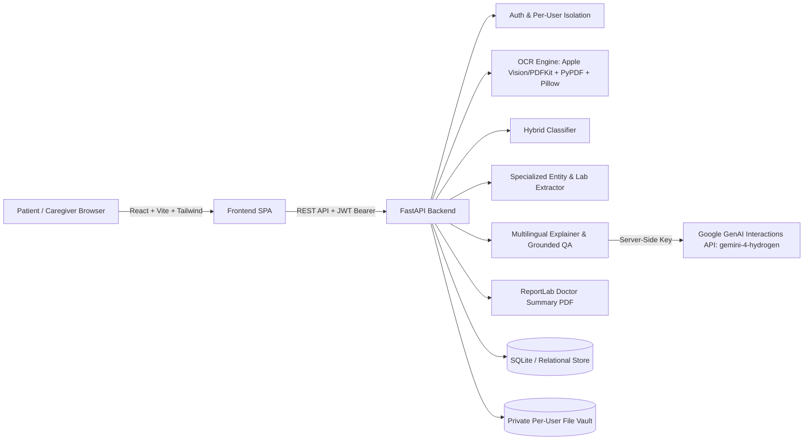
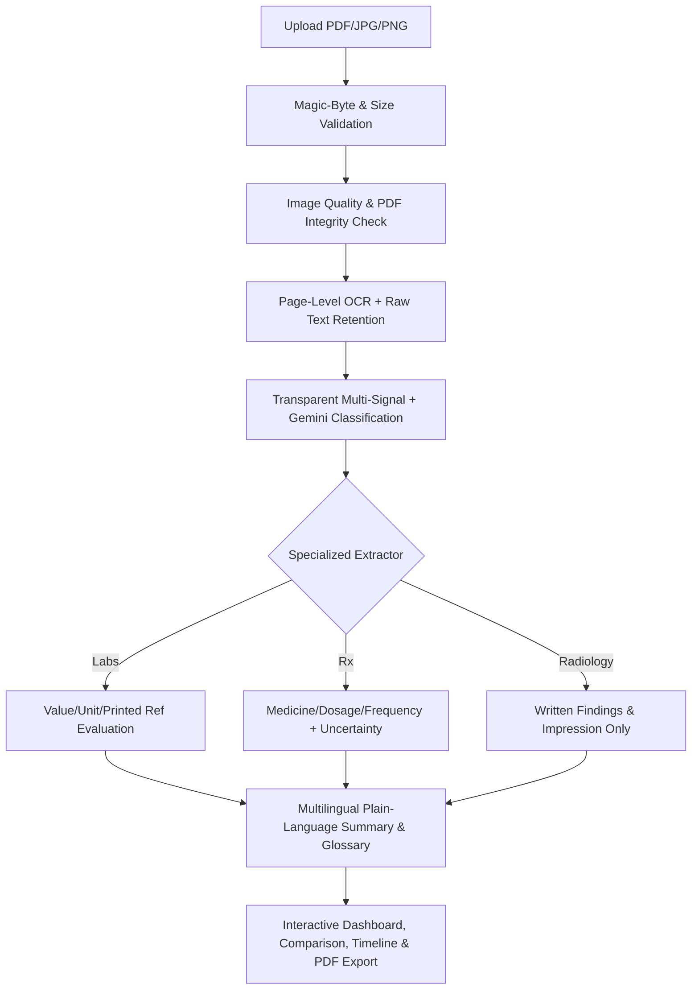

# MediScan AI

**Tagline:** *Understand Your Health. Decode Your Reports.*

MediScan AI is a multilingual, safety-first medical document intelligence platform built for patients and caregivers. It converts complex medical PDFs and scanned documents into plain-language, source-grounded insights across 8 languages without ever diagnosing conditions or replacing qualified healthcare professionals.

---

## 1. Problem Statement

Patients frequently receive dense laboratory reports, prescriptions, discharge summaries, and written radiology reports filled with unfamiliar abbreviations, inconsistent units, and no plain-language context—often in a language they do not read comfortably. Generic chatbots hallucinate medical facts, invent missing reference intervals, or compare incompatible measurement units.

## 2. Solution & Innovation

MediScan AI implements a **provenance-grounded, unit-safe medical intelligence pipeline**:
- **Specialized Document Pipelines** across 7 document classes (`blood_test`, `urine_test`, `prescription`, `radiology`, `discharge_summary`, `clinical_notes`, `other`).
- **Hybrid OCR & Quality Diagnostics** preserving page numbers, per-line confidence, and quality warnings on blurry/poor scans.
- **Transparent Classification** showing confidence and matched evidence signals, with one-click manual correction that re-runs the specialized extractor.
- **Strict Reference-Range Fidelity**: Compares numeric results *only* against printed reference intervals—never inventing missing ranges.
- **Unit-Safe Comparison & Timeline**: Normalizes canonical biomarker names (`Hb` ↔ `Hemoglobin`) while explicitly refusing to compare incompatible or missing units (`mg/dL` vs `mmol/L`).
- **Grounded Document Q&A & Clinician PDF Export**: Answers questions strictly from extracted text with page citations (or states when unavailable), and exports a structured ReportLab PDF summary for clinician visits.
- **8-Language Support**: Full UI and explanation support for English, Hindi, Bengali, Tamil, Telugu, Marathi, Spanish, and French.

---

## 3. System Architecture



## 4. AI Processing Pipeline



---

## 5. Technology Stack

- **Frontend:** React 18, Vite, Tailwind CSS, React Router, Lucide React, Recharts, Framer Motion
- **Backend:** Python 3.14, FastAPI, Pydantic v2, PyJWT, PyPDF, Pillow, ReportLab
- **AI & OCR:** Google GenAI SDK (`google-genai`, `gemini-4-hydrogen` via Interactions API) + native macOS `Vision.framework` & `PDFKit.framework` OCR (`mediscan-ocr`) with `pypdf` fallback
- **Database & Storage:** SQLite (`backend/data/mediscan.db`) with strict `user_id` access controls and configurable auto-deletion retention

---

## 6. Local Setup & Running

### Backend
```bash
cd backend
cp .env.example .env   # Optional: add GEMINI_API_KEY for live Gemini explanations
../.venv/bin/uvicorn app.main:app --reload --port 8000
```

### Frontend
```bash
cd frontend
npm run dev
```

### Build & Tests
```bash
# Backend pytest suite
cd backend && ../.venv/bin/pytest -v

# Frontend production bundle
cd frontend && npm run build
```

---

## 7. Deployment

- **Backend (Render):** Uses `render.yaml` (`uvicorn app.main:app --host 0.0.0.0 --port $PORT`). Configure `GEMINI_API_KEY` and `CORS_ORIGINS` in Render environment variables.
- **Frontend (Vercel):** Deploy `frontend/` with `npm run build` (`dist/`), SPA rewrites via `frontend/vercel.json`, and `VITE_API_BASE` pointing to the deployed Render backend URL.

---

## 8. Hackathon Live Demonstration Script (3 Minutes)

1. **Privacy & Consent Onboarding (0:20):** Register with explicit healthcare disclaimer consent and select a preferred language.
2. **Synthetic Multi-Report Kit (0:40):** Click **Load Synthetic Demo Kit** on the Dashboard to generate 4 synthetic PDFs (2 longitudinal blood panels, 1 prescription, 1 chest X-ray written report).
3. **Document Intelligence & Classification (0:45):** Open a blood report, inspect printed reference range flags (`below_range`, `above_range`, `reference_unavailable`), switch source verification tabs, and demonstrate manual classification correction.
4. **Grounded Assistant & Multilingual UI (0:35):** Ask *"What was my Hemoglobin?"* (returns cited answer) and *"What was my Troponin?"* (explicitly states unavailable), then switch the UI to Hindi/Spanish.
5. **Unit-Safe Comparison, Timeline & Doctor PDF (0:40):** Compare Jan vs Apr blood reports, inspect the Prescription Reader uncertainty badge, and download the Doctor Summary PDF.

---

## 9. Future Scope

- PostgreSQL managed storage with encrypted-at-rest object buckets (S3/GCS).
- HL7 FHIR R4 export for direct EHR interoperability.
- Clinician-verified multilingual medical terminology benchmarks.
